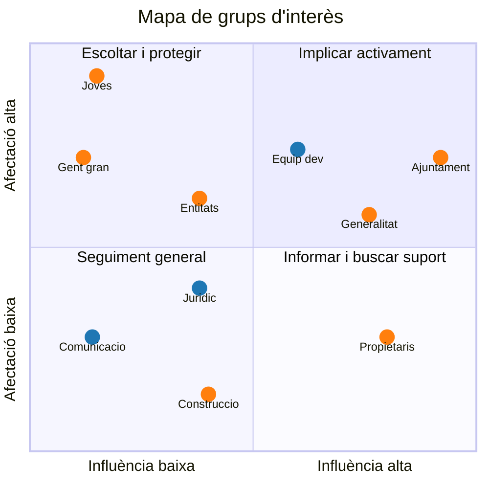

# Activitat 1.5. Grups d'interès i aliances

## 1. Membres i rols
* **Membre 1:** Iker Cañete – Recerca i gestió técnica/audiovisual
* **Membre 2:** Jaskaran Singh – Recerca i coordinació
* **Membre 3:** Adam Kharmich – Recerca i documentació
## 2. Definició i classificació dels grups d'interès

| # | Grup | Tipus | Definició |
|---|---|---|---|
| 1 | Equip de desenvolupament | Intern | Persones que dissenyen, programen i mantenen l'app. |
| 2 | Equip jurídic i de continguts | Intern | Persones que revisen la normativa de lloguer, ajuts i HPO i la tradueixen a contingut comprensible. |
| 3 | Equip de comunicació i atenció a l'usuari | Intern | Persones que difonen el projecte, recullen opinions i atenen dubtes dels usuaris. |
| 4 | Joves (18-35 anys) | Extern | Usuaris principals; pateixen els preus i els sous baixos. |
| 5 | Gent gran amb pensions baixes | Extern | Afectats per pujades i pel risc de desnonament. |
| 6 | Ajuntament de Barcelona | Extern | Competent en habitatge, ajuts i habitatge de protecció oficial. |
| 7 | Generalitat de Catalunya | Extern | Fixa la regulació del lloguer i gestiona ajuts. |
| 8 | Propietaris, immobiliàries i fons d'inversió | Extern | Fixen preus; part d'ells contribueix a l'especulació (fons voltors). |
| 9 | Entitats socials i sindicats de llogaters | Extern | Assessoren i defensen els afectats. |
| 10 | Sector de la construcció, rehabilitació i formació | Extern | Empreses i centres que poden crear habitatge, ocupació i formació en rehabilitació. |

## 3. Taula d'anàlisi

| Grup | Intern / Extern | Com li afecta el problema? | Què necessita o espera? | Afectació | Influència | Paper en la solució |
|---|---|---|---|---|---|---|
| Equip de desenvolupament | Intern | Pot obtenir un benefici si el projecte funciona; ha de gestionar els efectes mitjançant l'app | Dades fiables, temps, recursos tècnics | Mitjà | Alta | Desenvolupar i mantenir l'app |
| Equip jurídic i de continguts | Intern | Ha de gestionar els efectes: la normativa canvia i cal explicar-la bé | Fonts oficials, assessorament legal | Mitjà | Mitjana | Verificar la legalitat dels lloguers i redactar guies de drets |
| Equip de comunicació i atenció | Intern | Rep consultes de persones afectades i pot veure afectada la seva feina si l'app no funciona | Canals de difusió, retorn dels usuaris | Mitjà | Mitjana | Sensibilitzar, captar usuaris i recollir propostes de millora |
| Joves | Extern | Pateixen directament els preus i la marxa de la ciutat | Informació, ajuts, lloguers assequibles | Alt | Baixa | Utilitzar i validar l'app, compartir pis |
| Gent gran | Extern | Pateixen directament; risc de desnonament amb pensions baixes | Protecció, assessorament, estabilitat | Alt | Baixa | Aportar testimonis, ser atesos per les entitats |
| Ajuntament de Barcelona | Extern | Ha de gestionar els efectes socials | Compliment de normes, cohesió social | Mitjà | Alta | Dades, ajuts, HPO, difusió |
| Generalitat de Catalunya | Extern | Ha de gestionar els efectes | Compliment de la regulació | Mitjà | Alta | Establir normes i finançar |
| Propietaris, immobiliàries i fons | Extern | Generen o contribueixen al problema; poden veure afectada la seva activitat per la regulació | Rendibilitat, seguretat jurídica | Mitjà | Alta | Oferir lloguers assequibles i complir la normativa; limitar l'especulació |
| Entitats socials i sindicats | Extern | Gestionen casos de desnonament i pujades | Recursos, visibilitat, coordinació | Alt | Mitjana | Assessorar, formar, sensibilitzar |
| Construcció, rehabilitació i formació | Extern | Poden obtenir un benefici si es resol | Demanda, mà d'obra qualificada, inserció laboral | Baix | Mitjana | Rehabilitar, oferir feina i formació |

## 4. Mapa d'influència i afectació

**Llegenda:** 🔵 grups interns (Equip dev = Equip de desenvolupament, Juridic = Equip jurídic i de continguts, Comunicacio = Equip de comunicació i atenció) · 🟠 grups externs (Entitats = Entitats socials i sindicats, Construccio = Construcció, rehabilitació i formació, Propietaris = Propietaris, immobiliàries i fons)

| Zona | Estratègia | Grups |
|---|---|---|
| Influència alta i afectació alta | Implicar-lo activament | Ajuntament, Generalitat, Equip de desenvolupament |
| Influència alta i afectació baixa | Mantenir-lo informat i buscar-ne el suport | Propietaris (immobiliàries i fons) |
| Influència baixa i afectació alta | Escoltar-lo, protegir-lo i facilitar-ne la participació | Joves, Gent gran, Entitats socials |
| Influència baixa i afectació baixa | Seguiment general | Equip jurídic, Equip de comunicació, Construcció i formació |

## 5. Els tres grups més rellevants

### Joves 
1. **Afectació:** pateixen directament els preus i sous que no ho cobreixen.
2. **Necessitats:** informació clara, ajuts, habitatge assequible i opcions per compartir.
3. **Influència:** baixa de manera individual, però alta col·lectivament com a usuaris.
4. **Per què és important:** són el públic objectiu; sense ells l'app no té sentit.
5. **Participació:** utilitzar i validar l'app i aportar propostes de millora.

### Ajuntament de Barcelona
1. **Afectació:** ha de gestionar la crisi d'habitatge i la marxa de veïns.
2. **Necessitats:** compliment de la normativa i cohesió social.
3. **Influència:** alta (ajuts, HPO, dades, permisos).
4. **Per què és important:** pot donar legitimitat i dades oficials.
5. **Participació:** soci institucional amb dades i difusió.

### Entitats socials i sindicats de llogaters
1. **Afectació:** atenen casos de desnonament i pujades abusives.
2. **Necessitats:** recursos, coordinació i visibilitat.
3. **Influència:** mitjana, però molt alta en confiança i coneixement.
4. **Per què és important:** coneixen els casos reals.
5. **Participació:** assessorar el contingut jurídic i derivar usuaris.

## 6. Proposta d'aliances

### Aliança 1: Equip de Llar BCN + Ajuntament de Barcelona
- **Participants:** equip promotor i àrea d'habitatge de l'Ajuntament.
- **Objectiu:** que l'app ofereixi informació oficial i actualitzada d'ajuts i HPO.
- **Aportacions:** l'equip, l'app i les consultes dels usuaris; l'Ajuntament, dades, assessorament i difusió.
- **Benefici:** fiabilitat.
- **Dificultat:** burocràcia i calendaris diferents.
- **Com iniciar-la:** contacte amb l'àrea d'habitatge o amb un servei municipal d'atenció; 

### Aliança 2: Equip de Llar BCN + entitats socials i sindicats de llogaters
- **Participants:** equip promotor i entitats d'assessorament.
- **Objectiu:** orientar sobre pujades abusives i desnonaments.
- **Aportacions:** les entitats, coneixement jurídic i casos; l'equip, la plataforma tecnològica.
- **Benefici:** contingut fiable i confiança dels usuaris.
- **Dificultat:** capacitat limitada de les entitats i protecció de dades.
- **Com iniciar-la:** una reunió informativa per presentar el projecte.

## 7. Fonts d'informació consultades
- Constitució Espanyola, art. 47 (dret a un habitatge digne).
- ODS 11 i ODS 8 (Nacions Unides, https://www.un.org/sustainabledevelopment/es/sustainable-development-goals/).

